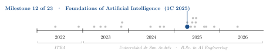
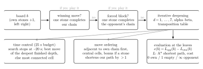
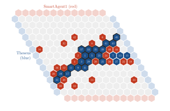
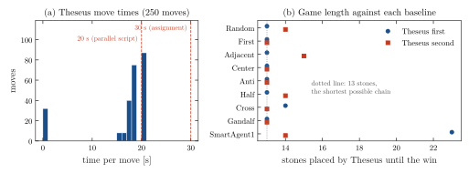
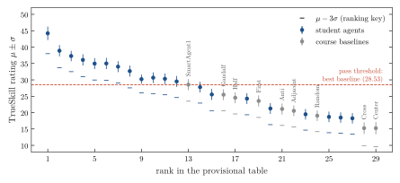

<div align="center">

# Theseus: an Alpha-Beta Hex Agent with Shortest-Path Evaluation

**Santiago Groba Alonso**

Universidad de San Andrés · *Foundations of Artificial Intelligence* · First semester 2025 · Assignment 1

[](#reproducing-the-results)
[](#reproducing-the-results)

<picture>
  <source media="(prefers-color-scheme: dark)" srcset="docs/figures/trajectory-dark.svg">
  
</picture>

</div>

> **Abstract.** The assignment asked for an agent that plays Hex on a 13×13 board inside a course-provided Gymnasium environment and is ranked against the whole class in a Swiss tournament scored with TrueSkill; to pass, an agent must out-rate every baseline agent written by the course staff, under a limit of 30 s per move. This repository contains my agent, *Theseus* (`grobaAgent.py`); the course framework it plugs into is not included. It runs an alpha-beta minimax search with iterative deepening up to depth 7, scores leaf positions by the difference between the opponent's and its own shortest connecting path (computed with A*), orders moves by connectivity, and checks for immediate wins and forced blocks before searching. Replaying the final version against the nine baseline agents, once with each colour, Theseus won 18 of 18 games, 12 of them with the minimum of 13 stones. The version submitted at the deadline was disqualified from the provisional ranking for exceeding the time limit; the fix that followed keeps every move under 20.5 s (median 18.0 s over 250 moves), well inside the 30 s limit.

---

## 1. Problem

Hex is played on a rhombic board of hexagonal cells. One player connects the left and right edges, the other the top and bottom edges, and the game cannot end in a draw. The course framework (`hex_udesa`, a Gymnasium environment) always shows an agent the board from its own point of view: its stones are $+1$, the opponent's are $-1$, and it connects left to right (the second player receives the board transposed and negated).

An agent is a class with `action(board)`, `name()`, `__str__()` and `reset()`, placed in `scripts/agents/<surname>/`. The constraints were:

| Constraint | Value |
|---|---|
| Board in the tournament | 13 × 13 |
| Time per move / to build the agent | 30 s / 2 s |
| Execution | single thread, no Numba or Cython |
| Memory / precomputed data | 500 MB RAM / 20 MB on disk |
| Rating | TrueSkill, Swiss tournament against every submitted agent |
| Pass condition | rating above the best baseline agent provided by the course |

## 2. Methods

Figure 1 summarizes the decision procedure of `GrobaAgent.action()`.

| Component | Choice |
|---|---|
| Immediate tactics | Before any search, play a cell that completes our chain; otherwise block a cell that would complete the opponent's chain (checked with DFS between edges) |
| Search | Minimax with alpha-beta pruning and iterative deepening, depth 1 to 7 (capped at 3 when time runs short) |
| Evaluation | $e(b) = L_\mathrm{opp}(b) - L_\mathrm{own}(b)$, where $L$ is the length of the shortest edge-to-edge path found by A* with cell cost 0 (own stone), 1 (empty), $\infty$ (opponent stone); $\pm 1000$ for a finished chain |
| Move ordering | Cells adjacent to our own stones first, then by distance to the centre, plus bonuses for cells that shorten our path by more than one stone or extend our chain horizontally |
| Caching | Transposition table for minimax values and a cache of path lengths, keyed by a hash of the board |
| Opening | Centre cell when the board has at most one stone |
| Time control | 25 s internal budget; the search stops at about 20 s and returns the best move of the deepest completed depth, or the most connected cell |

<p align="center"></p>

**Figure 1.** Decision procedure of Theseus. The three lower boxes are the parts used inside the search.

The tournament framework was provided by the course and is not part of this repository: the Gymnasium environment (`hex_udesa`), the Swiss tournament with TrueSkill rating and the baseline agents.

## 3. Results

### 3.1 Games against the baseline agents

The final version of Theseus was replayed against the nine baseline agents that take part in the tournament (`docs/figures/run_matches.py`), once as first and once as second player, on the 13×13 board and with the same board transformation as the tournament code.

<p align="center"></p>

**Figure 2.** Final position of the longest replayed game, Theseus (blue, left to right, moving first) against SmartAgent1 (red, top to bottom). Numbers give the move order; the outlined stones form the winning chain, completed at move 45.

**Table 1.** Result and number of Theseus stones on the board when the game ended (13 is the minimum on a 13×13 board).

| Baseline agent | Theseus first | Theseus second |
|---|---:|---:|
| Random | won, 13 | won, 14 |
| First | won, 13 | won, 13 |
| Adjacent | won, 13 | won, 15 |
| Center | won, 13 | won, 13 |
| Anti | won, 13 | won, 13 |
| Half | won, 13 | won, 14 |
| Cross | won, 14 | won, 13 |
| Gandalf | won, 13 | won, 13 |
| SmartAgent1 | won, 23 | won, 14 |

<p align="center"></p>

**Figure 3.** (a) Time per move of Theseus in the 18 games. The 14 opening moves (centre cell) and the 18 winning moves take under 0.1 s; every other move runs until the time control stops the search, after 15.8–20.5 s. No move reached the 30 s limit of the assignment, but 87 of 250 exceeded 20 s, the default of `swiss_tournament_paralell.py`. (b) Stones placed by Theseus until the win. Timings were measured with nine games running in parallel on a shared 12-core machine.

### 3.2 Provisional class tournament

The course published a provisional ranking on 15 April 2025, 17:00; its numbers are copied in `docs/figures/make_figures.py`. It ranks 29 agents by $\mu - 3\sigma$ of their TrueSkill rating; 12 of the 20 ranked student agents were above the pass threshold set by the best baseline, SmartAgent1 ($\mu = 28.53$).

<p align="center"></p>

**Figure 4.** TrueSkill rating $\mu \pm \sigma$ of the agents in the provisional ranking; baselines are labelled in gray, student agents are not named. The dashed line is the pass threshold.

Theseus does not appear in that ranking: the version submitted on 13 April was disqualified with a timeout rate of 100 % after 6 matches. That version gave the search a 29 s budget measured from the start of the search, so the untimed win and block checks before it, and any overrun inside it, left no margin below the 30 s limit. The commit of 15 April ("Correccion de tiempo") introduced the time control of Section 2; Figure 3 shows its effect. The final tournament ranking is not recorded in this repository.

## 4. Takeaways

- A shortest-path evaluation (the opponent's shortest connection minus ours) is enough to beat every baseline from both sides of the board, most of the time with the minimum number of stones.
- Time limits are part of the specification. Checking the clock inside the search is not enough when the budget leaves no margin and the work done before the search is not counted; the fix was a single, smaller budget measured from the start of `action()`.
- With a fixed budget, the agent spends about 18 s even on obvious moves. Spending less time on them, or deciding when to stop from how much the best move changes between depths, would leave more time for the moves that matter.

## Reproducing the results

`grobaAgent.py` depends only on NumPy and implements the course's agent interface: `action(board)` receives the board from the agent's point of view (own stones $+1$, opponent's $-1$, connect left to right) and returns the flat index of the chosen cell.

```python
import numpy as np
from grobaAgent import GrobaAgent

agent = GrobaAgent()
board = np.zeros((13, 13))
board[6, 6] = -1
agent.action(board)   # 71, i.e. row 5, column 6
```

The figures are redrawn from the saved results:

```bash
pip install numpy matplotlib
python docs/figures/make_figures.py
```

`docs/figures/run_matches.py` replays Table 1 into `docs/figures/matches.json` (about 1 h). It imports the course's Hex environment and baseline agents, which are not public, so it has to be run from a checkout of the course repository with this agent in `scripts/agents/groba/`.

| File | Content |
|---|---|
| `grobaAgent.py` | Theseus, the agent described in this README |
| `docs/figures/` | Figure script, match replay script and its results (`matches.json`) |

## Acknowledgements

The environment, tournament scripts and baseline agents were written by the course staff of *Fundamentos de Inteligencia Artificial* (Gabriel Torre, Tomás Ravel) in the course repository `udesa-fia/FIA-TP1-2025-A`.

## Citation

```bibtex
@misc{groba2025hex,
  author       = {Groba Alonso, Santiago},
  title        = {Theseus: an Alpha-Beta Hex Agent with Shortest-Path Evaluation},
  year         = {2025},
  howpublished = {Universidad de San Andr{\'e}s, Foundations of Artificial Intelligence},
  url          = {https://github.com/Santi2065/hex-alpha-beta-agent}
}
```
